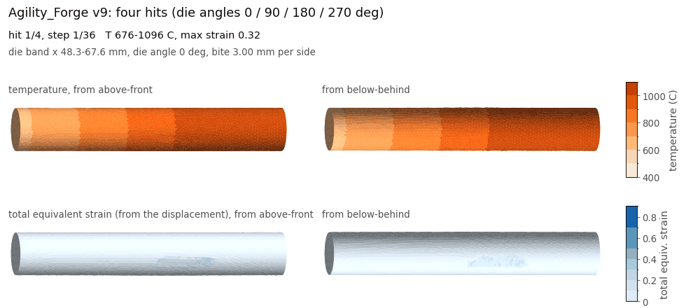
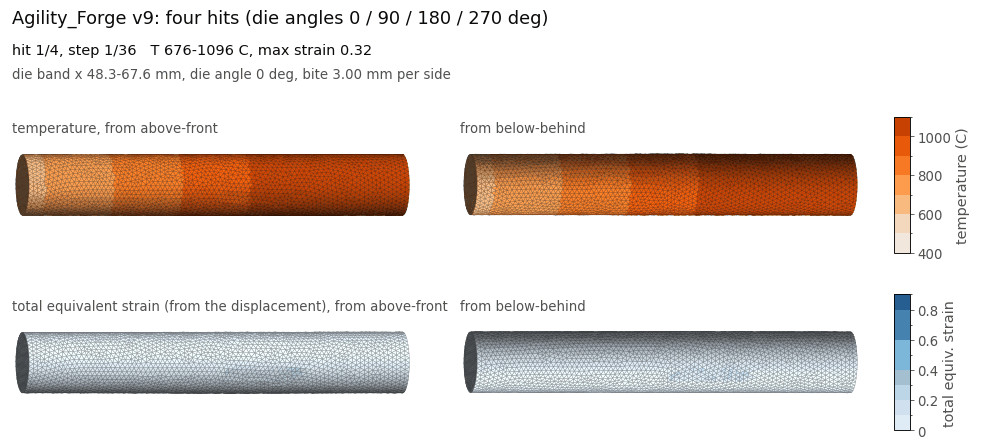

# Agility_Forge

Multi-hit thermo-mechanical forging demo on a cylindrical bar: a short,
scripted sequence of hits that shows the solver end to end.

Each *hit* presses two rigid platens into the bar over an axial band, at a die
angle about the bar axis. Contact is re-detected at every load step from the
current deformed shape (updated-Lagrangian), so material pushed away from a
platen is released automatically. Between hits the die is released gradually
and the temperature is ramped back to the initial profile before the next hit.

`Agility_Forge_data` runs the same model on the same bar to generate training
data; `Agility_Forge_physforge` replays a recorded physical forging run.

---

## 1. Quick start

Run from the **repository root** (the directory containing `applications/` and
`jax_fem_checkpoint/`), not from inside this folder:

```bash
python -m applications.Agility_Forge.main                    # three hits, 0 / -15 / 30 deg
python -m applications.Agility_Forge.main --schedule four    # four hits, 0 / 90 / 180 / 270 deg
```

Measured on one H100 (2026-11-12): `three` 28 min, `four` 45 min, every hit
converged without a failed step. Results go to

```
applications/Agility_Forge/data/vtk_tm_press_T_convect_tet_two_hits<tag>/hit_<N>/tm_<step>.vtu
applications/Agility_Forge/data/hit_<N><tag>_step_data.png
applications/Agility_Forge/data/hit_<N><tag>_step_data_scales.txt
```

Each `.vtu` carries `Displacement` (mm) and `Temperature` (deg C) on 7533
nodes, one file per accepted load step. The `.png` is the load scale reached at
each step of hit N annotated with the wall time of the step; the `.txt` lists
the scales. A new run clears the VTK directory and the plots with the same
`<tag>` first.

## 2. Results

`--schedule four`: four 3 mm hits at the same band, the die turned by 90 deg
between hits. Top row coloured by temperature, bottom row by the total
equivalent strain (computed from the displacement field); left and right are
the two sides of the bar.



The same run with the finite-element mesh drawn:



The `three` schedule is in `data/af_three_v9.gif` and
`data/af_three_v9_mesh.gif`.

## 3. Command-line options

| flag | meaning |
|---|---|
| `--schedule {three,four}` | scripted hits, see §4 (default: `three`) |
| `--n-hits N` | run only the first N hits of the schedule |
| `--tag TEXT` | suffix for the VTK directory and the per-hit plots, so several runs can coexist under `data/` |
| `--unload {peel,force}` | release between hits: `peel` (default, displacement control) or `force` (load control, unstable on this bar, kept for comparison) |
| `--unload-steps N` | release increments (default 10) |
| `--unload-time T` | pseudo-time of the release, s (default 1e-3) |
| `--unload-balance {self,raw}` | `force` release only: release the self-equilibrated part of the die reaction, or the reaction as captured |
| `--axial-constraint {face,face_rx,minimal3}` | rigid-body suppression at the held end (default `face`) |
| `--unload-vtk` | also write a VTK frame per release increment (diagnostics) |

```bash
# first hit only, results kept apart from a full run
python -m applications.Agility_Forge.main --n-hits 1 --tag _hit1
```

## 4. Hit schedules

The bar is 101.5 mm long (x from -5.0 to 96.5 mm) with a diameter of 15.9 mm;
the band is given as a fraction of H = 96.5 mm and is located on the bar as it
is at the start of the hit. Bite = platen travel per side.

### `three` (default)

| hit | band (fraction of H) | band (mm) | bite | die angle | hit time |
|---:|---|---|---:|---:|---:|
| 1 | 0.50 ... 0.70 | 48.3 ... 67.6 | 2.5 mm | 0 deg | 0.8 s |
| 2 | 0.65 ... 0.85 | 62.7 ... 82.0 | 2.5 mm | -15 deg | 0.8 s |
| 3 | 0.55 ... 0.75 | 53.1 ... 72.4 | 3.0 mm | 30 deg | 1.2 s |

### `four`

| hit | band (fraction of H) | bite | die angle | hit time |
|---:|---|---:|---:|---:|
| 1 | 0.50 ... 0.70 | 3.0 mm | 0 deg | 1.2 s |
| 2 | 0.51 ... 0.71 | 3.0 mm | 90 deg | 1.2 s |
| 3 | 0.50 ... 0.70 | 3.0 mm | 180 deg | 1.2 s |
| 4 | 0.50 ... 0.70 | 3.0 mm | 270 deg | 1.2 s |

To change a schedule, edit the `Hit(...)` entries in `main.py`
(`hit_config.py` documents the fields).

## 5. Model

* **Mesh**: `data/msh/jax_forge/assets/0104-00_jaxforge_stock.json`, 7533 nodes,
  30796 TET4 cells. `open3d` is optional: without it the existing `.json` is used.
* **Material**: 15-5PH stainless steel, finite-strain J2 plasticity with F-bar
  and temperature-dependent yield stress and hardening (`lib/constitutive.py`,
  `material_data.py`), coupled with heat conduction and heat from plastic work.
* **Initial temperature**: linear along the bar from 676 C at the held end to
  1096 C at x = 72 mm, uniform 1096 C beyond.
* **Held end**: on the end face x = -5 mm the axial displacement is fixed and
  one node is pinned (`--axial-constraint face`; `face_rx` also fixes the
  rotation about the bar axis, `minimal3` uses three nodes only).
* **Die contact**: a node of the band's outer surface is captured when it
  reaches the platen plane and is then held there, keeping its tangential
  position (no slip); the die only pushes, it never pulls a node onto the
  plane. The set is re-detected at every load step.
* **Die chilling**: heat flows to the 25 C platens through h = 1e4 W/m^2-K,
  only on the faces in contact.
* **Between hits**: peel release of the contact (outermost nodes first, 10
  increments), then a contact-free 10-increment ramp of the temperature back
  to the initial profile, then the next hit's contact is built on the released
  surface.

## 6. Model corrections (November 2026)

Eleven defects of the earlier model were corrected (table below). They are
built in; there are no switches to restore the previous behaviour. The same
corrections are in `Agility_Forge_physforge`, whose README (§2a) gives each
defect, the fix and what was measured. **Results computed before these
corrections came from the previous model.**

| # | correction |
|---:|---|
| 1 | contact band located on the bar as it is at the start of the hit, not on the reference coordinates |
| 2 | the die only pushes: a captured node that does not penetrate is held, not pulled onto the platen plane |
| 3 | peel release between hits instead of dropping all contact rows at once |
| 4 | plasticity history committed with the step's own temperature and dt, not T = 0 C, dt = 0.1 s |
| 5 | every bicgstab solve checked, failed ones redone with a sparse LU |
| 6 | die heat flux only on the faces in contact |
| 7 | heat capacity and die transfer lumped onto the nodes |
| 8 | thermal terms use the step's own dt (the first dt had been frozen in by JIT) |
| 9 | exact face areas for the die flux (reference normal in Nanson's formula) |
| 10 | die flux only on true boundary faces |
| 11 | surface cooling relaxes toward 20 C, not 0 C |

`jax_fem_checkpoint` is shared with the other applications and is not modified;
the face-area and boundary-face fixes live in `lib/boundary_conditions.py`.

## 7. Files

```
main.py                      driver: hit schedules, per-hit loop, release, reheat ramp, CLI
hit_config.py                Hit dataclass
material_data.py             15-5PH temperature tables (hardening)
mesh_container.py            mesh loading
lib/constitutive.py          thermo-mechanical weak form, J2 + F-bar, die heat transfer
lib/boundary_conditions.py   dynamic contact, peel release, rigid-body constraints, surface integrals
lib/time_stepper.py          adaptive load stepping with step-halving, surface cooling
lib/mesh_container.py        mesh helpers
data/msh/                    stock mesh (.obj, .json)
data/af_four_v9*.gif         the results above; data/af_three_v9*.gif the three-hit run
```
