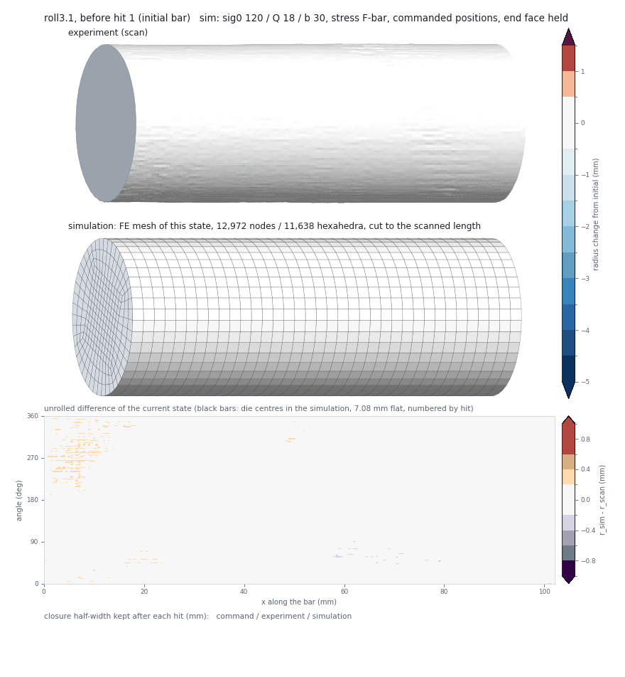
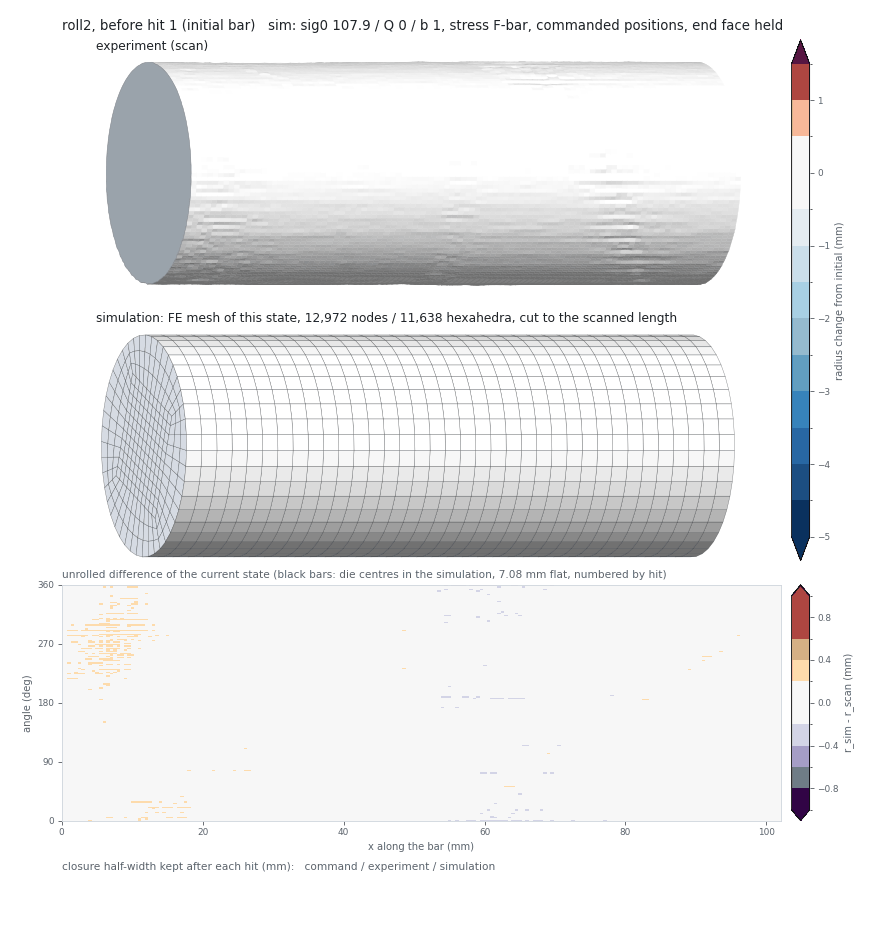

# Agility_Forge_Cooling: 6063 aluminium at 400 C

Simulation of two recorded incremental forging runs, `roll2` and `roll3.1`, on
6063 aluminium bars (diameter 38.1 mm, 100 mm exposed length) at a nominal
400 C. Each run is 12 hits, and the press delivers every hit as two closures.
The simulated bar is compared with the 3-D scan taken after every hit and with
the measured press force.

The package is self-contained: it uses `jax_fem_checkpoint` (repository root)
and third-party libraries, and imports no other application.

## Assumptions

* **Isothermal, 400 C.** No temperature was recorded; the thermal field is
  solved but does not reach the mechanics.
* **Reheat between hits.** Every hit starts stress-free and unhardened on the
  current shape.
* **Material.** Rate-independent J2 plasticity, Voce hardening
  `sig0 + Q (1 - exp(-b alpha))`, E 54 GPa, nu 0.33; roll3.1 sig0 120 MPa,
  Q 18 MPa, b 30; roll2 sig0 107.9 MPa, Q 0, b 1.
* **Machine.** Rigid dies and die holder; the hit positions and angles are the
  commanded ones; the closure radii come from the press record.
* **Held end.** Every node of the end face is fixed.

## What differs from the other examples

| | Agility_Forge, _data, _physforge | Agility_Forge_Cooling |
|---|---|---|
| material | 15-5PH steel, temperature-dependent | 6063 aluminium at one temperature |
| temperature | conduction, die chilling, reheat ramp | isothermal |
| between hits | plastic history carried, die released gradually | state reset, new mesh |
| die contact | captured nodes pinned to a flat band, no slip | penalty contact on the real die shape, Coulomb friction 0.1 |
| closures per hit | one | two, with a retract after each |
| elements | TET4, fixed mesh | HEX8 with F-bar, remeshed |
| held end | axial face plus pinned nodes | whole end face fixed |
| linear solver | bicgstab with a sparse-LU fallback | MUMPS |

## Pipeline

1. **Inputs from the record** (once per series): `extract_press.py` cuts the
   press stream into per-hit force curves, `achieved_rho.py` gives the closure
   radius each hit actually reached (the press stalled on one hit),
   `stroke_rho.py` gives the radii of the two strokes of each hit.
2. **Mesh**: `mesh_hex.py` builds the O-grid HEX8 billet
   (`billet_hex_h28.msh`: 11 cells per quarter arc, 3 ring layers, 2.83 mm
   axial layers; 12,972 nodes, 11,638 elements; x from -15 to 115 mm).
3. **Every hit**:
   1. *Remesh*: a new O-grid mesh is fitted to the current surface. Axial
      layers are 0.70 mm at the walls of the coming hit's band (a fine zone
      reaching 3.5 mm beyond each wall) and 2.83 mm elsewhere, graded by 1.3;
      existing imprint walls are not refined.
   2. *Die*: placed on the bar as it is now and turned to the hit's angle.
   3. *Strokes*: close to the first-stroke radius, retract, close onto the
      target radius, retract.
   4. *Quality guard*, in every stroke: when the smallest scaled Jacobian falls
      below 0.05, the nodes are relocated (surface nodes may slide on the old
      surface, up to 20 times per stroke) and the die backs off by the largest
      penetration; if the relocated mesh stays below 0.2, a new O-grid mesh is
      fitted to the committed shape. The state is re-sampled onto the new Gauss
      points each time.
   5. *Checkpoint* of the state at the end of the hit.
4. **Post-processing**: each hit's dent in the scans, the closure each hit
   kept, the force misfit, and the comparison GIFs.

**Die shape.** The real die (`Tool2.stl`) has a 7.08 mm flat, a 3.175 mm fillet
and an 83 deg flank, 25.4 mm high. The model uses the 7.08 mm flat with a
smooth logistic wall of width 0.5 mm up to 25.4 mm, which, like the fillet,
reaches 2.5 mm at 3.2 mm past the edge. Every lateral surface node is a
contact candidate at every step; the die pushes with a penalty stiffness of
E times the smallest edge length (9.35e4 N/mm per node), never pulls, and
Coulomb friction mu = 0.1 acts in both tangential directions (stick up to a
slip of 0.01 mm).

## Results

`roll3.1`: scan of the real bar (top), simulated mesh (middle), and the radius
difference simulation minus scan (bottom).



`roll2`:



Without the mesh: `data_400C/img/{roll2,roll3.1}_cmd_12hits_exp_vs_sim.gif`.

| | roll3.1 | roll2 |
|---|---|---|
| hits completed | 12 / 12 | 12 / 12 |
| closure kept on each hit's own flat, simulation minus command | +0.04 ... +0.08 mm | +0.05 ... +0.06 mm (11 hits) |
| peak force vs measured | hits 1-6 within -15 ... +10 %; hits 7, 9-12 1.8-3.3 x too high | misfit 11 % on hits 1-3, 15 % on all 12; hits 8-12 14-30 % too low |
| mesh volume change | -1.0 % | -0.2 % |
| run time, one H100 | 369 min | 130 min |

## Running

From `calib_400C/`, with the repository root on `PYTHONPATH` and the series in
`AGF_SERIES`:

```bash
export PYTHONPATH=/path/to/repository
COMMON="--band 7.08 --strokes two --rho-source achieved --stroke-target command \
  --band-config deformed --ele-type HEX8 --mesh ../data_400C/calibration/billet_hex_h28.msh \
  --contact penalty --die-profile sigmoid --friction-mu 0.1 --final-release \
  --hit-reset full --hit-remesh ogrid --remesh-slope-deg 0 --stroke-relocate surface \
  --min-scaled-jacobian 0.05 --relocate-max 20 --stroke-remesh ogrid \
  --fbar-form stress --linear-solver mumps --fast-linear --axial-constraint face_fixed \
  --save-vtk --n-hits 12"

AGF_SERIES=roll3.1 python -u run_cold.py --tag s5_cmd   $COMMON --sig0 120   --Q 18 --b 30
AGF_SERIES=roll2   python -u run_cold.py --tag r2_cmd12 $COMMON --sig0 107.9 --Q 0  --b 1
```

Results go to `data_400C/calibration/<series>/sim_<tag>/`: `sim_00NN.vtu` (the
bar after hit NN), per-stroke VTK folders, `sim_log_strokes.json` (force and
travel of every stroke) and `checkpoints/state_hitNN.npz`; continue with
`--resume-from <run>/checkpoints/state_hitNN.npz`.

The derived inputs and the mesh are included. To rebuild them:

```bash
AGF_SERIES=roll3.1 python extract_press.py
AGF_SERIES=roll3.1 python achieved_rho.py
AGF_SERIES=roll3.1 python stroke_rho.py
python mesh_hex.py --h 2.8 --out ../data_400C/calibration/billet_hex_h28.msh
```

## Post-processing

From `calib_400C/postprocess/` (CPU):

```bash
R=../../data_400C; S=$R/calibration/roll3.1
python dent_full.py $R/info/raw/roll3.1.h5 $S          # -> dent_full_roll3.1.json (included)
python closure_own_dent.py $S/sim_s5_cmd dent_full_roll3.1.json phi
python calib_eval.py $S $S/sim_s5_cmd --hits 1,2,3,4,5,6,7,8,9,10,11,12
MESH=1 python gif_hits_3d.py $R/info/raw/roll3.1.h5 dent_full_roll3.1.json $S/sim_s5_cmd \
    $R/calibration/billet_hex_h28.msh 12 roll3.1.gif "roll3.1"
```

`dent_full.py` writes its result next to itself, i.e. it replaces the
included `dent_full_<series>.json` (a rerun reproduces it).

## Layout

```
calib_400C/
  run_cold.py                  simulation driver
  paths.py                     input and output paths of the selected series
  contact.py                   outer-surface nodes, die rotation, press force
  lib/                         constitutive model, die contact, friction, O-grid
                               remeshing, state transfer, time stepper, MUMPS
  mesh_hex.py, extract_press.py, achieved_rho.py, stroke_rho.py   pipeline step 1-2
  postprocess/                 pipeline step 4
data_400C/
  info/raw/                    recorded runs: .h5 scans, .pt, .mcap press stream,
                               _toolpath.jsonl commands (roll2, roll3.1)
  info/torm_tool_lib/Tool2.stl die geometry
  calibration/billet_hex_h28.msh
  calibration/<series>/        inputs derived from the record and the results
                               (sim_r2_cmd12 for roll2, sim_s5_cmd for roll3.1)
  img/                         the GIFs above
```

## Requirements

`jax`, `numpy`, `scipy`, `meshio`, `basix`, `petsc4py` built with MUMPS, and
`jax_fem_checkpoint` on `PYTHONPATH`. Post-processing also needs `h5py` and
`matplotlib`; re-extracting the press data needs `mcap` and `zstandard`
(the press stream is zstd-compressed).

## Known limits

* `roll2` hits 1-3 do not identify the hardening (every Q, b tried fits within
  10.4-11.9 %), hence Q 0, b 1.
* The die holder is rigid in the model; on `roll3.1` hits 8 and 11 the real
  flat came out 12-14 deg from the commanded angle.
