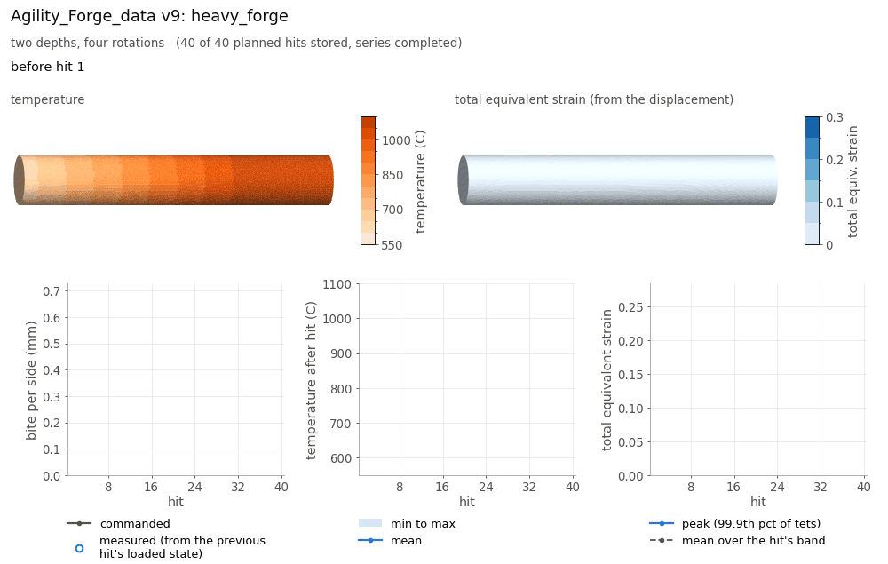
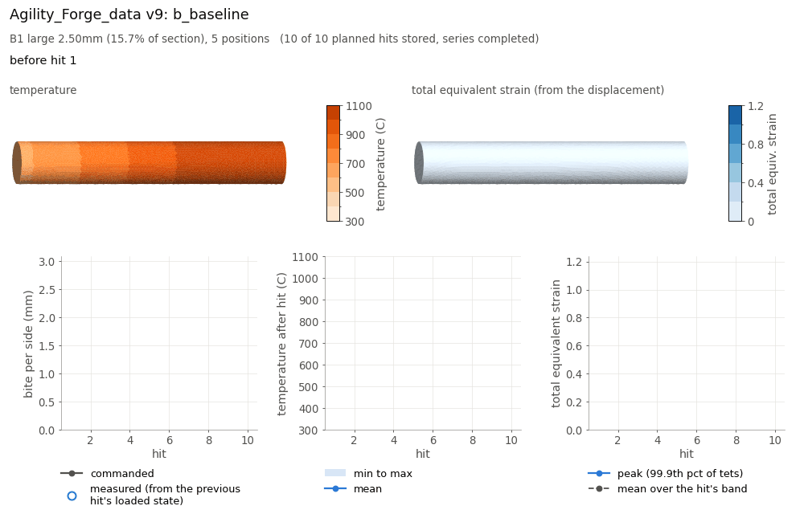

# Agility_Forge_data

Multi-hit thermo-mechanical forging simulation on a cylindrical billet, used to
generate (input state, hit parameters) -> (output state) training pairs.

Each *hit* presses two rigid platens into the bar over a narrow axial band, then
the bar is rotated about its axis before the next hit. Contact is re-detected at
every load step from the current deformed shape (updated-Lagrangian), so material
pushed away from a platen is released automatically; a captured node keeps its
tangential position (no slip) and the die only pushes. Between hits the die is
released gradually and the temperature is relaxed back towards the initial
profile.

This README describes version 9 (the model of November 2026, §7).

---

## 1. Quick start

Run from the **repository root** (the directory containing `applications/` and
`jax_fem_checkpoint/`), not from inside this folder:

```bash
python -m applications.Agility_Forge_data.main -s one_press -n 1 --no-noise --save-vtk
```

That is 5 hits, about 30 min on one H100 (version 9: 28 min measured for a
noisy `one_press` series). Results go to

```
applications/Agility_Forge_data/data/vtk_one_press_s0000/hit_<N>/tm_<step>.vtu
applications/Agility_Forge_data/data/forge_database.db
```

Each `.vtu` carries `Displacement` (mm) and `Temperature` (deg C) on 7533 nodes.
VTK output is off by default (`run.save_vtk: false`); the database is always
written.

The database (SQLite) has a `series` table (sequence, planned hits, status) and
a `hits` table with one row per hit: the band (`x_min_band`, `x_max_band`, as
fractions of H on the reference bar), the bite (`compression_displacement`, mm
per side), the die angle (`rotation_euler_x`, deg), and the nodal displacement
and temperature before the hit (`input_*`) and at its end (`result_*`, die
still closed; the release belongs to the next hit), stored as JSON arrays.

## 2. Results (version 9 test, 2026-11-12)

One noisy series of every sequence (`-n 1 --noise --seed 42`, no VTK, one H100
per batch): every sequence completed all its hits, 143 hits in total.

| sequence | hits | wall time | GIF |
|---|---:|---:|---|
| `one_press` | 5 | 0.46 h | `data/data_one_press_v9.gif` |
| `press_rotate` | 10 | 0.97 h | `data/data_press_rotate_v9.gif` |
| `progressive` | 20 | 2.11 h | `data/data_progressive_v9.gif` |
| `heavy_forge` | 40 | 4.20 h | `data/data_heavy_forge_v9.gif` |
| `s_baseline` | 10 | 0.98 h | `data/data_s_baseline_v9.gif` |
| `s_edge_low` | 8 | 0.97 h | `data/data_s_edge_low_v9.gif` |
| `s_edge_high` | 8 | 0.75 h | `data/data_s_edge_high_v9.gif` |
| `s_norot` | 10 | 0.97 h | `data/data_s_norot_v9.gif` |
| `b_baseline` | 10 | 1.85 h | `data/data_b_baseline_v9.gif` |
| `b_concentrated` | 8 | 1.70 h | `data/data_b_concentrated_v9.gif` |
| `b_edge` | 8 | 1.42 h | `data/data_b_edge_v9.gif` |
| `b_extreme` | 6 | 1.42 h | `data/data_b_extreme_v9.gif` |

Each GIF is drawn from the database: the bar before hit 1 and after every hit,
coloured by temperature (left) and by the total equivalent strain computed from
the displacement (right; the database stores no plastic strain), the hit's band
marked by dashed lines. Below, per hit: the bite commanded and the bite measured
on the bar (half the loss of section thickness across the band along the die
normal; it is measured from the previous hit's end state, die still closed, so
a repeat hit on the same spot reads low by that spot's springback), the
temperature after the hit, and the strain.

`heavy_forge`, 40 hits:



`b_baseline`, 10 large-strain hits:



## 3. Command-line options

Every flag overrides the matching entry in `configs/forging.yml`; omit it to keep
the YAML value.

| flag | meaning |
|---|---|
| `-s, --sequence NAME [NAME ...]` | which sequence(s) to run (default: all) |
| `-n, --n-series N` | independent series per sequence (default: `run.n_series`) |
| `--seed N` | RNG seed for the hit noise |
| `--save-vtk` / `--no-save-vtk` | write per-step VTK |
| `--noise` / `--no-noise` | randomise bite depth, rotation and band centre |
| `-c, --config PATH` | alternative `forging.yml` |
| `--db PATH` | SQLite output path |

Use `--no-noise` for reproducible single runs; leave noise on when generating
training data.

## 4. Available sequences

The bar is a cylinder of 15.9 mm diameter; its forgeable span is x = 0 ... 96.52
mm (a 5 mm stub at x < 0 is the held end). The die footprint is 19.3 mm
(`scan.band_width_mm`).

### Data-generation sequences

| sequence | hits | bite | landing points | purpose |
|---|---:|---:|---|---|
| `one_press` | 5 | 0.40 mm | 0.4 ... 0.8 | one depth, no rotation |
| `press_rotate` | 10 | 0.40 mm | 0.4 ... 0.8 | one depth, 0 deg and 90 deg |
| `progressive` | 20 | 0.40 mm | 0.4 ... 0.8 | two depths, two rotations |
| `heavy_forge` | 40 | 0.35 mm | 0.4 ... 0.8 | two depths, four rotations |

```bash
# 100 noisy series of the 20-hit sequence, no VTK (dataset generation)
python -m applications.Agility_Forge_data.main -s progressive -n 100 --noise --no-save-vtk

# every sequence, 3 series each
python -m applications.Agility_Forge_data.main -n 3
```

### Validation scenarios

These exercise the deformed-band mapping and the die-contact model at their
limits. `bite %` is the fraction of the 15.9 mm section removed per hit.

| sequence | hits | bite | landing | what it probes |
|---|---:|---|---|---|
| `s_baseline` | 10 | 0.40 mm (2.5%) | 0.4 ... 0.8 | small-strain reference |
| `s_edge_low` | 8 | 0.40 mm (2.5%) | 0.05 | die overhangs the **clamped** end |
| `s_edge_high` | 8 | 0.40 mm (2.5%) | 0.95 | die overhangs the **free** end |
| `s_norot` | 10 | 0.40 mm (2.5%) | 0.4 ... 0.8 | no rotation, section flattens one way |
| `b_baseline` | 10 | 2.50 mm (15.7%) | 0.4 ... 0.8 | large-strain reference |
| `b_concentrated` | 8 | 2.50 mm (15.7%) | 0.50 | every hit on one spot |
| `b_edge` | 8 | 2.50 mm (15.7%) | 0.90 | large strain at the free end |
| `b_extreme` | 6 | 3.50 mm (22.0%) | 0.5 ... 0.7 | convergence limit |

```bash
# small-strain regression (~1 h on one H100)
python -m applications.Agility_Forge_data.main -s s_baseline -n 1 --no-noise --save-vtk

# large-strain regression (~1.9 h on one H100)
python -m applications.Agility_Forge_data.main -s b_baseline -n 1 --no-noise --save-vtk

# all four small-strain scenarios in one go
python -m applications.Agility_Forge_data.main -s s_baseline s_edge_low s_edge_high s_norot -n 1 --no-noise --save-vtk
```

Expected outcome (version 9, measured, see §2): all eight complete.
`b_concentrated` is the hardest: hit 8 needed one step-halving, and 8 x 2.50 mm
= 20 mm of cumulative bite on a single spot exceeds the 15.9 mm section, so the
mesh under the die is severely distorted by then; deeper or longer variants of
it may stop on element quality, which is a limit of the mesh, not a solver
defect. (With the version 8 model it stopped at hit 8, during the
inter-hit thermal relaxation.) `b_edge` applies the same bite at a different
landing point.

## 5. Configuring your own sequence

Add a block to `configs/forging.yml`:

```yaml
my_sequence:
  description: 'what this does'
  hot_zone: [0.3, 0.9]        # optional; overrides scan.hot_zone
  position_configs:
    - depths: [1.0, 1.5]      # mm of platen travel per side, per hit
      rotations: [0.0, 90.0]  # degrees about the bar axis
```

Hits are the full product `band_centres x depths x rotations`. Band centres are
laid out across `hot_zone` with `scan.overlap` between neighbours, so a wider hot
zone yields more hits.

Shared settings under `scan:`

| key | meaning |
|---|---|
| `band_width_mm` | physical die width in mm, constant for the whole run |
| `hot_zone` | forgeable span, as a fraction of the **current** bar length |
| `overlap` | overlap between adjacent band positions |
| `v_platen` | platen speed in mm/s (`total_time = bite / v_platen`) |

Two warnings can appear and are worth reading:

* `[band][warn] die overhangs the ... end` — the landing point puts part of the
  die past the end of the stock. Clamping is physically correct (only part of the
  die face touches metal) but the contact area, and hence the pressure, is
  reduced by the reported fraction.
* `[hits][warn] hot_zone lower bound puts the die edge at ... mm` — forging next
  to the clamped end face is legal but numerically harder, because the plastic
  zone cannot flow that way. Measured: a band reaching x = 0 produced 10-14
  step-halving events over 8 hits; the mirrored case at the free end produced
  none. Keep the lower bound at 0.3 or above unless you specifically want this.

## 6. How the die follows the bar

The bar elongates as it is forged (up to +17% in `b_baseline`), so the die
position and width are recomputed before every hit rather than being fixed to the
undeformed bar:

* `hot_zone` is a fraction of the **current** forgeable span, so "60% along the
  bar" stays at 60% as the bar grows.
* `band_width_mm` is a **physical** width. The die is steel and does not widen
  with the workpiece, so the corresponding band on the reference mesh shrinks as
  the material stretches (19.30 mm -> 16.44 mm over 10 hits in `b_baseline`).
* The mapping back onto the reference mesh **inverts the actual displacement
  field** instead of assuming uniform stretch. Cogging is deliberately
  non-uniform — hit sections elongate, untouched sections do not — and with a
  uniform-stretch assumption the die can land several millimetres off target.

Each hit prints the result:

```
[band] rod L=104.57mm, landing 47.28mm (frac 0.500) -> ref band 18.05mm for 19.30mm die
```


## 7. Model corrections (November 2026)

The model carries the corrections of `Agility_Forge_physforge` (its README,
§2a, has the defects, the fixes and the measurements). They are built in; there
are no switches to restore the previous behaviour. The code before
2026-11-09 is kept outside the repository.
**Every series generated before these corrections was computed with the
previous model.**

| correction | since |
|---|---|
| die heat flux only on the faces in contact (nodal contact mask) | before Nov 2026 |
| heat capacity and die transfer lumped onto the nodes; thermal terms use the step's own dt; reference-normal area weights (physforge #6-#8) | 2026-11-05 |
| plasticity history committed with the step's own temperature and dt, not T = 0 C, dt = 0.1 s (physforge #4) | 2026-11-09 |
| every bicgstab solve checked, failed ones redone with a sparse LU (physforge #5) | 2026-11-09 |
| the die only pushes: a captured node that does not penetrate is pinned, not pulled onto the platen plane (physforge #2) | 2026-11-09 |
| between hits the contact is released gradually ("peel": contact nodes freed outermost first, the rest pinned where the hit left them, the rotation about x held at its current value), then the reheat ramp runs contact-free and the next hit's rows are built on the released surface; previously the rows were dropped at once on the first reheat step (physforge #3) | 2026-11-09 |
| the die flux only on true boundary faces; interior faces with all vertices in the die node set took it too (physforge #9) | 2026-11-09 |
| the phenomenological surface cooling relaxes the surface toward 20 C, not 0 C (physforge #10) | 2026-11-09 |

`lib/constitutive.py` and `lib/time_stepper.py` are identical to physforge's up to
the package name. The release (`build_unload_bcs`) and the die-contact targets
were checked function by function against physforge's on the same mesh and
inputs: identical (internal validation, not in the repository).
This package keeps its own mapping of the commanded band onto the deformed bar
(§6) and has no force-controlled release or checkpoints.

Effect on a `one_press` series (5 hits, 7533 nodes, GPU, 16 steps per hit in
every run; runs `dt_before`, `dt_A` (ported fixes), `dt_C` (ported fixes +
interior faces + 20 C); internal validation, not in the repository):

| hit | ported fixes vs before: max `|du|` (mm) / max `|dT|` (C) | interior faces + 20 C vs ported: max `|du|` (mm) / max `|dT|` (mean) (C) |
|---|---|---|
| 1 | 0.118 / 40.2 | 0.003 / 70.6 (0.07) |
| 2 | 0.184 / 39.7 | 0.003 / 57.3 (0.05) |
| 3 | 0.216 / 52.4 | 0.002 / 0.04 (0.02) |
| 4 | 0.179 / 59.9 | 0.002 / 0.04 (0.02) |
| 5 | 0.181 / 63.0 | 0.002 / 0.04 (0.02) |

`|u|_inf` is 1.3-1.5 mm.  The die surfaces drop 10-20 interior faces of
676-710 selected; the temperature changes only in hits 1 and 2 (the reheat
between hits resets it, so the change does not carry over).
