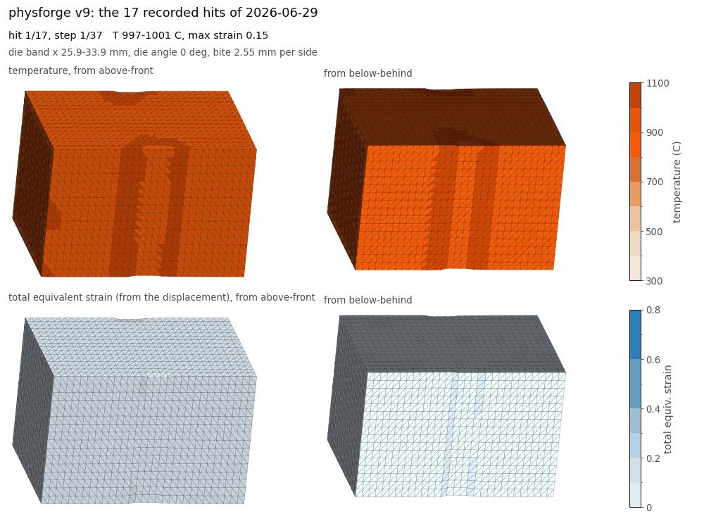

# Agility_Forge_physforge

Reproduction of a **recorded physical forging run** (17 hits, `2026-06-29`) on a
rectangular billet, using the same thermo-mechanical solver as
`Agility_Forge_data`.

Where `Agility_Forge_data` generates synthetic training data on a cylinder, this
package replays the measured hit parameters of the real run: hammer position,
die angle, and the per-hit reduction measured from the before/after 3-D scans
of the workpiece.

The default billet is a box with the scan's bounding-box dimensions,
59.3 x 40.5 x 39.7 mm. The real bar was round (diameter about 39.5 mm), so the
box does not reproduce its cross-section and the simulated shape is not compared
with the scans; `--mesh` loads other cross-sections (§4).

Die contact: a node of the band's outer surface is captured when it reaches the
platen plane and is then held there, keeping its tangential position (no slip);
the die only pushes. The set is re-detected at every load step.

This README describes version 9 (the corrections of November 2026, §2a).

---

## 1. Quick start

Run from the **repository root** (the directory containing `applications/` and
`jax_fem_checkpoint/`):

```bash
python -m applications.Agility_Forge_physforge.run_physforge \
    --n-hits 2 --save-vtk \
    --depth-source scan --axial-constraint face_rx
```

The contact band, the die, the between-hit transition, the plasticity-history
update, the linear solver and the thermal discretisation were corrected in
November 2026; the corrections are built in (no switches since 2026-11-09) and
§2a describes each change and what was measured.

Two hits, about 10 min on one H100 (version 9: 289 s and 295 s for hits 1 and
2). The recorded hit parameters ship with the package
(`data/physforge_hits_2026-06-29.npz`, `data/physforge_scan_depths.npz`), so no
external data file is needed.

Output:

```
applications/Agility_Forge_physforge/data/vtk_physforge/hit_<N>/tm_<step>.vtu
applications/Agility_Forge_physforge/data/physforge.db
```

## 2. Recommended settings

`--depth-source scan` and `--axial-constraint face_rx` are **not** the
defaults; the defaults (`u0`, `face`) are the settings of the original run,
kept for reference but known to be wrong. Use these for any new work:

| flag | value | why |
|---|---|---|
| `--depth-source` | `scan` | `u0` in the record is the hammer **stroke**, not the plastic reduction. The measured ratio ranges 0.26-1.19 across the 17 hits, so no single scale factor works; `scan` takes the per-hit reduction straight from the before/after scans. |
| `--axial-constraint` | `face_rx` | The default `face` leaves one rigid-body mode unconstrained (rotation about x through the pin: it produces no `ux`, so none of the 289 face constraints see it). `face_rx` adds one transverse constraint to fix it. |

The contact band is always selected in the current configuration (the real bar
elongated 59 -> 93 mm over the 17 hits), so the die presses the material that is at the commanded
position now (§2a #1). This supersedes `--axial-mode deformed`, the earlier
first-order (uniform-stretch) correction, which the driver refuses.

Full 17-hit run:

```bash
python -m applications.Agility_Forge_physforge.run_physforge --save-vtk \
    --depth-source scan --axial-constraint face_rx \
    --checkpoint-dir ~/physforge_ck
```

2.9 h on one H100 (version 9, 2026-11-12: all 17 hits converged, 34-72 load
steps per hit; one step of hit 17 was redone with a halved step). `--checkpoint-dir` writes `(displacement, temperature,
plasticity history)` after every hit; if the run is interrupted, resume with
`--resume-from N` where N is the last completed hit. Without a checkpoint there
is no way to continue: the plastic history lives only in memory, and neither the
VTK nor the DB stores it.

Result of that run: the simulated bar after each load step, coloured by
temperature (top) and by the total equivalent strain computed from the
displacement (bottom), seen from two sides; every 6th step of each hit and its
last step. The status lines give the hit's band (on the bar as it is at the
start of the hit), die angle and bite.


The same run with the finite-element mesh drawn:



## 2a. Model corrections (November 2026)

Eight defects were found while making the model differentiable, a ninth on
2026-11-05, and the surface cooling law was
changed on 2026-11-09 (#10). The fixes are built in. Until 2026-11-09 each
correction had a switch that restored the previous behaviour; with all of them
set back the package reproduced its earlier results to round-off (1e-12 mm over
three hits on the 637-node box), which is how every fix was verified. The
switches were then removed, since none of the previous behaviours is physically
right; the code with the switches is kept outside the repository, and the removal was
verified bit-identical on the corrected defaults (box, 2 hits, CPU).
Defects 6-9 change the temperature field by hundreds of degrees; see the
measurements after the notes below. Any result computed before them has far too
little conduction and far too much (or misplaced) die cooling.

| # | defect | fix | former switch, previous value |
|---|---|---|---|
| 1 | The axial contact band was selected on the **reference** coordinates, so the die followed the material instead of staying at the commanded position; the error is the band's accumulated axial displacement and grows every hit. | Band test applied to `pts + u` at the start of the hit, frozen within the hit. | `--band-config`, `reference` |
| 2 | A node inside the 0.1 mm capture layer was projected **onto** the platen plane even when that moved it outward: the die pulled the workpiece. | Normal target clamped (`max(y, y_L)`, `min(y, y_R)`); a captured, non-penetrating node is pinned where it is. | `--die-pull` |
| 3 | Between hits the previous contact rows were dropped **all at once** on the first reheat step, and the new hit's rows held 1-2 nodes at `scale = 0` meanwhile. | Displacement-controlled **peel** release: every node in contact at the end of the hit gets a rank by distance from its platen patch's centroid in the die plane, outermost first; at release fraction `s` the nodes with rank below `s` are free and the rest are pinned where the hit left them; at `s = 1` the body is free. The reheat ramp then runs contact-free and the new hit's rows are built on the released surface. See the notes below on why not force control, and on the rigid-body mode. | `--unload none` (removed; `peel` is the default, `force` remains an option) |
| 4 | The plasticity history was committed with the `T_old`/`dt` slots of the carried tuple, which are never written after `custom_init`: **T = 0 C, dt = 0.1 s**. The history used the cold material while the residual used the hot one. | `update_int_vars_gp` receives the step's own quadrature `T_old` and `dt` (`problem.internal_vars[5:8]`). | `--history-temp legacy` |
| 5 | The linear solver is an unpreconditioned bicgstab whose convergence check is commented out in `jax_fem_checkpoint`; a failed solve was returned as if it had succeeded. | `use_hybrid_linear_solver` (runtime rebinding, the package is not modified) checks `|Ax - b|` after every solve and redoes the failed ones with a sparse LU. | `--linear-solver jax` |
| 6 | The consistent heat-capacity and die-transfer terms couple neighbouring nodes with positive weights, so the implicit update is not monotone: a node next to a chilled one is pushed the other way (the 950 C bar reached 990.7 C, against 954.9 C lumped; the excess is not plastic work). | Both terms row-sum lumped onto the nodes; heat content, conduction and plastic heating unchanged. | `--thermal-lumping consistent` |
| 7 | **dt frozen in the thermal terms.** The kernel divided by `self.dt`, a Python float that JIT compiles in as a constant when the kernel is first traced; `set_timestep` no longer reached it. Each hit's thermal step kept the first dt (1e-3 s) whatever the real step was, so a 1.25 s hit of 37 steps had about 0.04 s of conduction and die cooling. | The kernel uses its `dt` argument, already refreshed for every solve by `set_timestep`/`set_params`. No gradient machinery is involved. The temperature rise from plastic work was not affected (both terms divide by the same dt). | `--thermal-dt frozen` |
| 8 | **Die-flux area over-counted on TET4.** `FiniteElement.get_face_shape_grads` in `jax_fem_checkpoint` puts the physical face normal into Nanson's formula, which needs the reference facet normal. Box y faces: 3.42 x and 1.98 x on alternate triangles, 2.70 x in total. | `reference_nanson_scale` (`lib/boundary_conditions.py`) recomputes the weights in `refresh_problem_surface_integrals`: ratio to the geometric area 1.000000000000. `jax_fem_checkpoint` is shared with other applications and is not modified. | `--face-area library` |
| 9 | **Die flux on interior faces.** `get_boundary_conditions_inds` in `jax_fem_checkpoint` selects every face of every cell whose vertices all satisfy the location function and never checks that the face is on the boundary; the die surfaces here are node sets, so an interior face with all its vertices in the set took the die flux too (twice: it belongs to two cells). Area of the selected faces over the true area: box 1.77, `bar_rect_tet` 1.49 / 1.33 / 1.25 (coarse / med / fine), taper 1.75, cylinder and rounded 1.00. This was the cold billet edge of the refinement table below. | `refresh_problem_surface_integrals` keeps only faces that belong to one cell (`true_boundary_face_flags`). Box, 2 hits, 950 C: T min over the run 90.6 -> 313.0 C. On the cylinder test mesh (no interior faces selected) the run is bit-identical. | none (found 2026-11-05, fixed 2026-11-09) |
| 10 | The stepper's phenomenological surface cooling multiplied the surface temperatures by `0.99**(dt/cool_factor)`, i.e. relaxed them toward 0 C. | They relax toward room temperature: `T <- T_ROOM + (T - T_ROOM) * 0.99**(dt/cool_factor)`, `T_ROOM = 20` C (`lib/time_stepper.py`). With `T_ROOM = 0` the run is bit-identical to the previous law. The law itself is kept (a physical convection + radiation boundary condition is in `Agility_Forge_physforge_full`). | none |

Measured on the 637-node box (`--nx 12 --ny 6 --nz 6 --band-width 12
--depth-source scan`), GPU:

* **Regression.** Previous code vs. corrected code with all switches at their
  previous values, 3 hits: `|du|_inf <= 1.3e-11 mm`, `|dT|_inf <= 5e-12 C`.
* **Peel release.** 10 increments, 5-9 Newton iterations each, no retries:
  springback `|du|_inf` 0.82 / 0.79 mm after hits 1 / 2, and 1.19 mm in the
  5 mm/side stress run (`--depth-scale 2`, 2 hits, also no retries). On the
  7533-node cylinder demo of `Agility_Forge` (3 hits, rotations 0 / -15 /
  30 deg): 0.63 / 0.65 mm, 6 iterations per increment, and the release is
  local -- the free end of the bar moves less than 0.15 mm.
* **Hybrid solver.** Over the 3-hit run 4 of the bicgstab solves failed the
  residual check, one with `|Ax - b| = 2e23`; the direct re-solve brought each
  to `< 1e-10`. In the 5 mm/side stress run (2 hits, `--depth-scale 2`) 9
  solves failed, several with `inf` or `1e150` residuals, all inside the
  unloading and reheat phases. The previous code hands these increments to
  Newton unchecked.
* **Deformed band.** Hit 3 of the 3-hit run selects 48 candidate nodes in the
  deformed configuration against 72 in the reference one: after two hits the
  commanded position holds different material.
* **Cost.** The corrected run is ~25-30% slower (residual checks, unloading).

**Why not force control (`--unload force`, kept as an option).** The first
implementation replaced the contact rows by the captured die reaction `R` as an
external force `lambda R`, ramped `1 -> 0`. It is exact at `lambda = 1` (the
residual at the released nodes reproduces the captured reaction to `4e-8 N`
against `1.3e5 N` when evaluated with the last step's own `T_old`/`dt`), and it
behaves on the box: 0.7-1.4 mm springback, 2-5 iterations per increment. On the
cylinder it fails in a way that is physics, not numerics: once the rows are
gone, the pinched band is held in rotation only by the bending stiffness of a
bar at 1096 C (E of 6 GPa) against a 13 kN pinch. Measured increment by
increment: the free end swung to -20 mm at `lambda = 0.3` and came back to
-12 mm at `lambda = 0`, a -7.6 deg rotation about z growing linearly beyond the
die, i.e. plastic rotation on an unstable load-controlled path. Removing the
rigid-body resultant of `R` first (`--unload-balance self`, the imbalance was
784 N of 13.5 kN there and 14.5 kN of 70 kN on the box) does not change this,
because the instability needs no net load. A real die opens under displacement
control and holds the band until contact is lost; the peel is the kinematic
model of that. The force option remains for stocky geometries and for
comparison.

**Rigid-body mode during the release.** The `face` constraint leaves the
rotation about x free; during a hit the platens hold it, but once the band is
released it is a zero-energy mode and the tangent is singular. Measured on the
cylinder demo: the release drifted 24 mm along it (a rigid rotation reported
as "springback") and the next hit's platen datum was 7 mm off.
`build_unload_bcs` therefore adds the `face_rx` node for the release and the
reheat ramp with its `uy` held at the current value, which removes the mode
without moving anything; with `face_rx` or `minimal3` nothing is added.

The reheat ramp between hits is unchanged (10 increments, `T_old` linearly
from the cooled end-state to the initial profile). It runs after the release,
contact-free.

The surface cooling of the stepper (`cool_factor`) relaxes the surface nodes
toward 20 C by `0.99**(dt/cool_factor)` each step (#10).

**Thermal corrections 6-8 against an exact solution.** A column 4 x 40 x 4 mm,
1 mm elements along y, one end against a 25 C die through h = 10 mW/mm^2-K, the
rest insulated; start 950 C, displacements fixed, no plastic heating, 1.2511 s
with the stepper's dt sequence. Exact (Carslaw & Jaeger semi-infinite solid):
surface 412.07 C. The stepper's surface cooling is not part of this test.

| thermal settings | surface T (C) | heat out / exact | T range over the run (C) |
|---|---|---|---|
| consistent, dt frozen, library area (before) | 718.93 | 0.076 | 621.9 ... 1025.5 |
| lumped, dt frozen, library area | 753.99 | 0.079 | 632.0 ... 950.0 |
| lumped, dt frozen, exact area | 828.34 | 0.050 | 775.7 ... 950.0 |
| lumped, dt of the step, library area | 293.97 | 1.268 | 261.8 ... 950.0 |
| **lumped, dt of the step, exact area (default)** | **414.62** | **1.004** | **411.2 ... 950.0** |
| consistent, dt of the step, exact area | 414.66 | 0.998 | 410.6 ... 994.9 |
| default, constant dt = 0.005 s (250 steps) | 412.36 | 1.008 | 409.2 ... 950.0 |

Script: internal validation, not in the repository.

**Effect on the forging** (637-node box, 2 hits, `--band-width 12 --depth-source
scan --temp 950`, CPU; 95 accepted solves and no retries in every row):

| thermal settings | T range over the run (C) | mean T, end of hit 2 (C) | plastic strain, max / mean | `|u|_inf` (mm) |
|---|---|---|---|---|
| consistent, dt frozen, library area (before) | 639.2 ... 990.7 | 942.30 | 0.524 / 0.0820 | 2.858 |
| lumped, dt frozen, library area | 759.2 ... 954.9 | 942.48 | 0.500 / 0.0804 | 2.926 |
| lumped, dt frozen, exact area | 814.5 ... 955.0 | 942.59 | 0.490 / 0.0799 | 2.970 |
| lumped, dt of the step, library area | 54.6 ... 955.1 | 927.00 | 0.619 / 0.0926 | 3.019 |
| **lumped, dt of the step, exact area (default)** | **90.6 ... 954.9** | **927.91** | **0.560 / 0.0919** | **2.894** |

With every thermal switch set back (`--thermal-lumping consistent --thermal-dt
frozen --face-area library`, switches removed since) the run was
**bit-identical** to the code before these three corrections (CPU, final u, T
and the plasticity history).  These rows predate #9 and #10; with them the
default row becomes T 313.2 ... 954.7 C (2026-11-09).

**Refinement, and an open point** (default settings, 1 hit, end of hit, C). The
contact-face core converges toward the exact solution; the stepper's surface
cooling, not in the exact solution, takes it a little lower. The billet edges under
the die do not behave that way:

| mesh | nodes | contact-face core, mean | billet edge under the die | overall max |
|---|---|---|---|---|
| 12 x 6 x 6 | 637 | 527.8 | 90.6 ... 646.0 | 954.8 |
| 24 x 12 x 12 | 4225 | 455.6 | 87.8 ... 558.3 | 954.8 |
| 48 x 24 x 24 | 30625 | 429.3 | 114.7 ... 561.9 | 954.7 |
| 12 x 6 x 6, non-obtuse (Kuhn) | 637 | 528.5 | 94.8 ... 685.7 | 954.8 |
| 24 x 12 x 12, non-obtuse (Kuhn) | 4225 | 455.8 | 91.2 ... 592.7 | 954.8 |

The coldest edge nodes stay near 100 C, several hundred degrees below their
neighbours on the same edge. Obtuse elements are not the cause (the non-obtuse mesh
gives the same). **Explained (2026-11-09): defect #9.** The coldest nodes were the
ones on interior faces that took the die flux; with only true boundary faces the
box run's minimum over two hits is 313.0 C instead of 90.6 C. The table above is
from before that fix.

**Do not take values from `XLA_FLAGS=--xla_gpu_deterministic_ops=true`.** In that
mode `a.at[inds].multiply(c)` and `a.at[inds].set(v)` return a wrong value at index
0 when `inds` contains 0, on the H100. The stepper's surface cooling then gives
node 0 a wrong temperature on the first step of a hit whenever node 0 is on the
surface. Normal GPU
mode and CPU are correct. Use CPU for bit-identity checks.
Scripts: internal validation, not in the repository.

## 3. Command-line options

| flag | default | meaning |
|---|---|---|
| `--hits PATH` | `data/physforge_hits_2026-06-29.npz` | recorded hit parameters |
| `--n-hits N` | all 17 | run only the first N hits |
| `--depth-source {u0,scan}` | `u0` | bite depth from the raw stroke, or from the scans |
| `--scan-depths PATH` | `data/physforge_scan_depths.npz` | measured per-hit reduction |
| `--closure-factor F` | 1.0 | scales `u0`; ignored when `--depth-source scan` |
| `--axial-mode {reference,deformed}` | `reference` | earlier first-order remap of the hammer position; superseded by the deformed-configuration band (§2a #1), `deformed` is refused |
| `--unload {peel,force}` | `peel` | between-hit release (§2a #3) |
| `--unload-steps N`, `--unload-time S` | 10, 1e-3 | release increments and the pseudo-time they span |
| `--unload-balance {self,raw}` | `self` | force mode only: release the self-equilibrated reaction or the raw one |
| `--unload-vtk` | — | write a VTK frame per release increment (diagnostics) |
| `--axial-constraint {face,face_rx,minimal3}` | `face` | how axial rigid-body motion is suppressed |
| `--band-width MM` | 8.0 | hammer footprint (assumed, not measured) |
| `--mesh PATH` | none | load the billet from a mesh file instead of generating a box; the bar axis must be x |
| `--ele-type {TET4,HEX8}` | auto | element type (auto-detected from `--mesh`, TET4 for a generated box) |
| `--surface-mode {topological,box}` | `topological` | how the outer lateral surface is found |
| `--depth-scale F` | 1.0 | multiply every bite by F, for stress-testing convergence |
| `--temp C` | 1000 | billet temperature (not in the record) |
| `--nx --ny --nz` | 30 16 16 | mesh resolution |
| `--checkpoint-dir DIR` | none | write per-hit checkpoints |
| `--resume-from N` | 0 | continue from checkpoint N |
| `--vtk-subdir NAME` | `vtk_physforge` | output folder under `data/` |
| `--save-vtk` / `--db PATH` | — | output control |

## 4. Arbitrary cross-sections

The bar axis must be x and the platens close along y, but the cross-section is
free.  Pass any meshio-readable file:

```bash
python -m applications.Agility_Forge_physforge.run_physforge \
    --mesh path/to/billet.msh --n-hits 2 --save-vtk \
    --depth-source scan --axial-constraint face_rx
```

The default `--surface-mode topological` finds the outer lateral surface from
mesh connectivity -- a face belonging to exactly one element is on the boundary,
and boundary faces whose nodes all sit at x=min or x=max are the end caps.
Nothing about the cross-section is assumed, so the same code handles a box, a
cylinder, a rounded rectangle or a tapered bar.  (`--surface-mode box` keeps the
older hand-written rectangular test; on a box mesh the two select an identical
node set.)

`make_test_meshes.py` generates the five meshes used to validate this:

```bash
python -m applications.Agility_Forge_physforge.make_test_meshes
```

Measured, 2 hits each, all with 37/38 Newton steps and zero NaN:

| mesh | element | nodes | surface nodes |
|---|---|---:|---:|
| rectangular | TET4 | 1767 | 790 |
| cylinder | TET4 | 1371 | 601 |
| rounded rectangle | TET4 | 1757 | 766 |
| tapered (0.53 taper) | TET4 | 1258 | 668 |
| rectangular | HEX8 | 1296 | 512 |


## 5. Layout

```
run_physforge.py             entry point: box mesh, hit loading, CLI
main.py                      per-hit loop, band re-mapping, checkpoints
hit_config.py                Hit dataclass
lib/constitutive.py          J2 finite-strain thermo-plasticity
lib/boundary_conditions.py   dynamic contact, rigid-body constraints, die cooling
lib/time_stepper.py          adaptive stepping with step-halving
read_pt.py                   torch-free reader for the original .pt record
extract_scan_depths.py       regenerates the bundled .npz from the .pt
make_test_meshes.py          builds the five validation meshes (needs gmsh)
data/physforge_hits_*.npz    recorded hit parameters (bundled)
data/physforge_scan_depths.npz   measured per-hit reduction (bundled)
data/pf_17hits_v9*.gif       the full 17-hit run of §2 (version 9)
data/                        also receives VTK output and the SQLite DB
```

`read_pt.py` and `extract_scan_depths.py` are only needed to regenerate the
bundled `.npz` files from the original 318 MB `2026-06-29.pt`; normal runs do not
touch them.

## 6. Relationship to `Agility_Forge_data`

This package started as a fork and adds three things: a box-billet surface test
injected via `surface_mask_fn`, a `bc_builder` hook in `run_forging_series`, and
`run_physforge.py` itself. The solver, material model and time stepper are
shared and unmodified.

Both packages carry the same model corrections (§2a): `Agility_Forge_data`
received the die-contact mask, the thermal corrections #6-#8, and on 2026-11-09
the plasticity-history, checked-solver, die-only-pushes and peel-release fixes
(#2-#5, ported from here; its `lib/constitutive.py` and `lib/time_stepper.py` are
now this package's up to the package name), the interior-face fix #9 and the
surface cooling toward 20 C #10. It keeps its own mapping of the commanded band
onto the deformed bar (its README §5) and has no force release or checkpoints.
