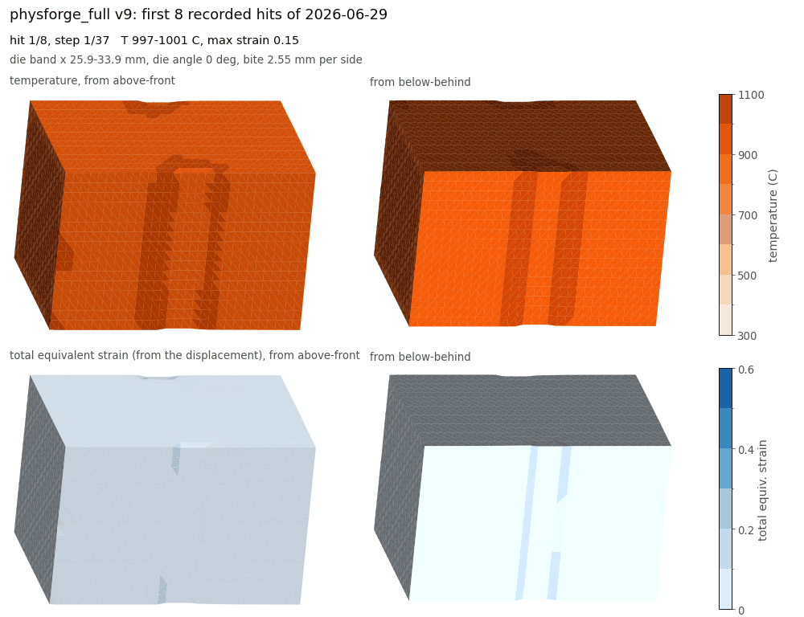
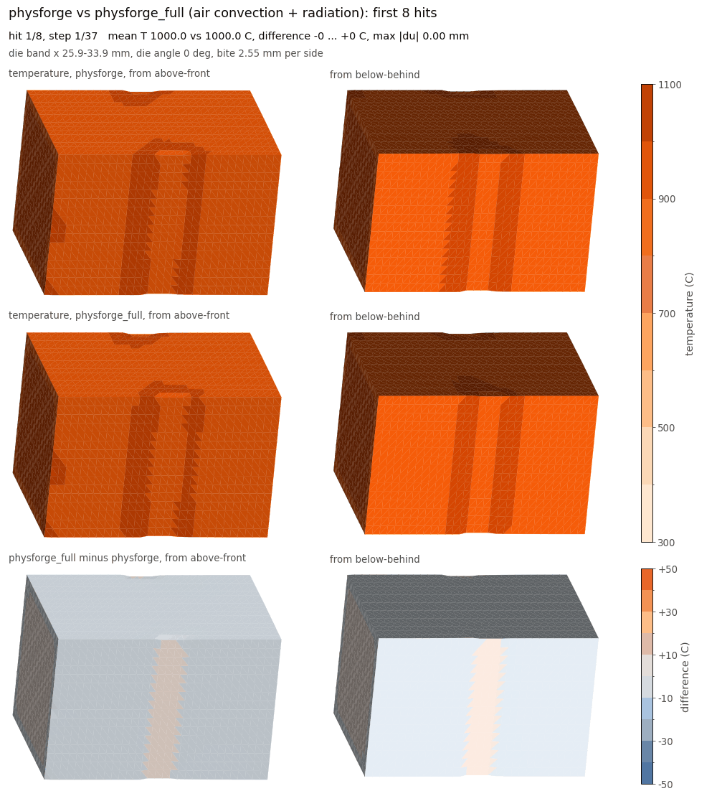

# Agility_Forge_physforge_full

`Agility_Forge_physforge` with a physical air boundary condition. Everything
else (the recorded 17-hit run of 2026-06-29, the box billet, the die contact,
the model corrections, the command-line options) is the same as in
`Agility_Forge_physforge`; see its README.

## What is added

Every outer face of the bar that is not pressed against a die loses heat to
the air by natural convection and radiation, during the hits, the release
between hits and the reheat ramp:

    q = h (T - T_air) + eps sigma ((T + 273.15)^4 - (T_air + 273.15)^4)

* `h`: natural convection of a horizontal cylinder in still air
  (Churchill-Chu correlation, air properties at the film temperature),
  evaluated once per run: about 10.4 W/m^2-K for the 40 mm bar at 1000 C.
* `eps` = 0.85 (oxidized stainless steel), `T_air` = 20 C. At 1000 C radiation
  carries about 90 % of the loss.
* The clamped end face stays adiabatic.
* It replaces physforge's phenomenological surface cooling (`cool_factor`).
* The reheat ramp between hits still resets the bar to the initial
  temperature profile.

Checks: the air surface area equals the geometric area of the outer faces to
1e-12; per step, the heat lost through the air surface equals the decrease of
the heat content to ~3e-13; an isothermal bar follows the scalar cooling ODE
to < 0.001 C.

## Run

From the repository root:

```bash
python -m applications.Agility_Forge_physforge_full.run_physforge --save-vtk \
    --depth-source scan --axial-constraint face_rx --checkpoint-dir ~/physforge_ck
```

Extra options: `--air-h` (W/m^2-K, default: the correlation), `--emissivity`
(default 0.85), `--air-temp` (C, default 20).

## Results (version 9, first 8 recorded hits)

On one H100: the same load steps in every hit as physforge, about 3 % slower.
At the end of each hit the mean temperature is 3-6 C lower than in physforge,
and about a quarter of the nodes (the surface) are cooler by 5-40 C; single
nodes differ by up to about 100 C. The deformation changes little: at most 1.6 mm at a
node, bar length within 0.07 mm.



With the finite-element mesh: `data/pffull_8hits_v9_mesh.gif`.

physforge (top) vs physforge_full (middle), and their temperature difference
(bottom):


