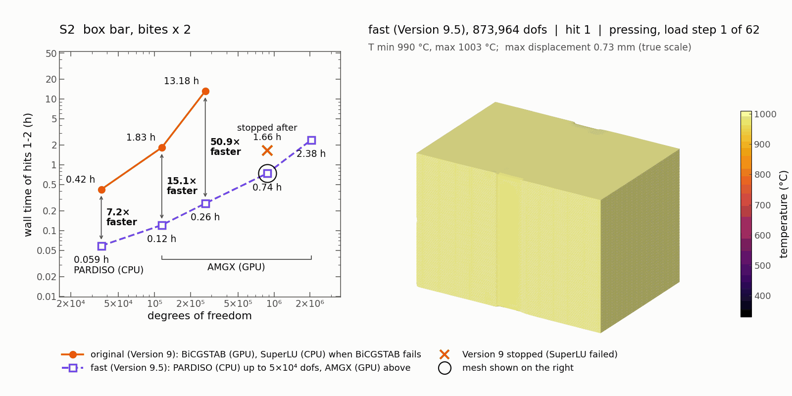
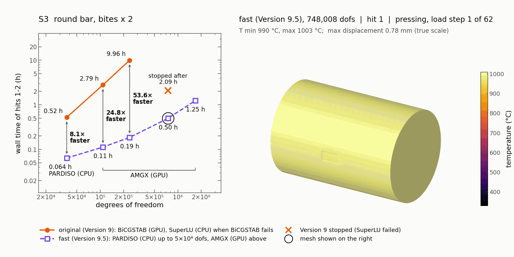

# Agility_Forge_physforge_full_fast

`Agility_Forge_physforge_full` with a faster solver. The model, the recorded
17-hit run, the box billet, the die contact, the air boundary condition and
the command-line options are the same; this package does not import
`Agility_Forge_physforge_full` and uses only the unchanged parts of
`jax_fem_checkpoint` (mesh, shape functions, problem set-up).

The Newton iterations are the same as in the original: on the first two hits
every load step takes the same number of iterations, and the end-of-hit state
differs by about 6e-10 mm and 2e-8 C, the same as two runs of the original.

## What is changed

* **Assembly on the GPU with a fixed sparsity pattern** (`lib/fast_system.py`).
  The mesh does not change during a run, so the CSR pattern of the coupled
  [u, T] Jacobian is built once and every cell matrix entry has a fixed slot
  in it. A Jacobian is one scatter-add on the GPU. The original sent the
  11.8 million cell-matrix entries to the CPU at every iteration, sorted them
  with scipy, converted to PETSc to zero the Dirichlet rows and back, and
  copied the matrix to the GPU again (27 % of its time).
* **Dirichlet rows through a per-dof mask** with the original semantics (row
  zeroed, diagonal 1; residual u - u_bc), so the contact set can change at
  every step without new array shapes or recompilation.
* **Element kernels on all cells at once** (or in batches of `--kernel-chunk`
  cells, each batch added into the residual and the matrix as soon as it is
  computed, so no array over all cells of cell matrices is formed),
  and **one plastic return map per quadrature point**: the original evaluated
  it separately for the stress and for the plastic multiplier, each with a
  fixed 50-step Newton loop. The loop now stops when the point has converged,
  which gives the same iterates.
* **Newton** (`lib/fast_newton.py`): the same algorithm, tolerances and line
  search; the residual of the accepted line-search point is reused, and no
  Jacobian is formed at the converged iterate.
* **Linear solver** (`lib/linear_solvers.py`): by default MKL PARDISO up to
  5e4 dofs (the symbolic analysis done once, since the pattern is fixed) and
  NVIDIA AMGX on node blocks above (u_x, u_y, u_z, T per node; aggregation
  multigrid inside FGMRES, relative tolerance 1e-10, matrix values passed on
  the GPU); the original BiCGSTAB as an option. Every solve is checked
  (|A dx - b| <= 1e-6 |b|). A failed AMGX solve is redone with a stronger
  AMGX set-up (`--second-solver amgxbe:gs`): the Dirichlet columns are
  eliminated as well (on the GPU; same solution) and the multigrid smoother
  is a symmetric multicolour block Gauss-Seidel sweep instead of damped
  block Jacobi. It costs about three times as much per solve, so it is used
  only after a failure; on large meshes with deep bites it replaces most of
  the direct-solver fallbacks (about 10 min each at 2M dofs). If it fails
  too, the solve is redone with BiCGSTAB and then with a direct solver.
* **No COO index arrays for the original assembly** (`lib/boundary_conditions.py`):
  they are built only for `--newton original` and `--fast-verify`, which use
  `jax_fem_checkpoint`'s scipy/PETSc assembly.
* **Start-of-stepper diagnostic in batches** (`lib/time_stepper.py`): the
  eigenvalues of the carried elastic strain are computed in batches of 1e6
  matrices; cuSolver rejects the ~1e7 integration points of a 2M-dof mesh in
  one call, and every rejected call left its GPU memory behind.

## Results

One NVIDIA H100 80 GB per run, November 2026 (versions as in Requirements).

**First 8 recorded hits**, default box mesh (8,959 nodes, 46,080 TET4,
35,836 dofs), the same options for both packages
(`--n-hits 8 --save-vtk --depth-source scan --axial-constraint face_rx`):

| | wall time | per Newton iteration | linear solve | solves redone with a direct solver |
|---|---:|---:|---:|---:|
| `Agility_Forge_physforge_full` | 92.5 min | 2.11 s | BiCGSTAB, after 0.54 s of CPU assembly | 14 |
| fast, PARDISO (the default at this size) | 10.8 min | 0.210 s | 0.147 s | 0 |
| fast, AMGX | 12.6 min | 0.254 s | 0.191 s | 4 |
| fast, BiCGSTAB (the original method) | 17.2 min | 0.362 s | 0.299 s | 11 |

Every hit has the same load steps; of the 505 Newton solves 0 (AMGX), 1
(BiCGSTAB) and 3 (PARDISO) took one iteration more or less (solves that end
just at the tolerance). At every load step the VTK fields agree to 9.5e-7 mm
and 0 C (the float32 resolution of the files); at the end of hit 8 the float64
state differs by at most 8.4e-10 mm, 9.7e-9 C and 1e-9 in the plastic
variables, the same as two runs of the original.

**Mesh size** (`--nx --ny --nz`; hit 1, load steps 2-12, time per Newton
iteration):

| mesh | dofs | original | fast, BiCGSTAB | fast, default solver |
|---|---:|---:|---:|---:|
| 30 x 16 x 16 | 35,836 | 1.70 s | 0.154 s | 0.19 s (PARDISO) |
| 45 x 24 x 24 | 115,000 | 3.42 s | 0.60 s | 0.35 s (AMGX) |
| 60 x 32 x 32 | 265,716 | 6.74 s | 1.60 s | 0.67 s (AMGX) |
| 90 x 48 x 48 | 873,964 | 23.0 s | 7.7 s | 1.95 s (AMGX) |
| 120 x 64 x 64 | 2,044,900 | not run | 27.1 s | 4.8 s (AMGX) |

The linear solvers scale differently: PARDISO takes 0.145 s at 36k dofs but
1.4 s at 115k and 91 s at 874k; BiCGSTAB needs more iterations on finer
meshes (about 550 at 36k, 1400 at 874k); block AMGX stays at 120-360
iterations. The default therefore uses PARDISO up to 5e4 dofs and AMGX
above. With AMGX the element kernel is the largest part on large meshes
(1.4 s per Jacobian at 874k dofs). On some systems of the two largest meshes
AMGX stops at 2000 iterations; these are now redone with the Gauss-Seidel
AMGX set-up (see the scenario study below). This table was measured on
16 November, before the second AMGX set-up and the per-batch assembly were
added.

**Scenario study** (17 November, final code; hits 1-2 including the release
and reheat stage, no VTK; one H100 per run). S1: the box billet with the
recorded bites; S2: the box billet with the bites doubled (`--depth-scale 2`,
5.1-5.2 mm per side); S3: a round bar (radius 20.03 mm, gmsh TET4 mesh) with
the bites doubled. The original was run up to about 250k dofs; at 750k-870k
it stopped at its first direct-solver fallback (scipy's SuperLU could not
enlarge its LU storage), so it was not run on the two largest meshes.

| scenario | dofs | original | fast | speed-up | Newton iterations (original / fast) | AMGX solves redone with the Gauss-Seidel set-up / with a direct solver | max abs(u_fast - u_original) (mm) |
|---|---:|---:|---:|---:|---:|---:|---:|
| S1 | 35,836 | 16.6 min | 2.6 min | 6.3x | 436 / 435 | 0 / 0 | 6.8e-10 |
| S1 | 115,000 | 84.2 min | 4.8 min | 17.6x | 458 / 459 | 0 / 0 | 7.0e-11 |
| S1 | 265,716 | 6.94 h | 9.6 min | 43.5x | 472 / 472 | 2 / 0 | 4.7e-09 |
| S1 | 873,964 | stopped after 1.71 h | 30.2 min | - | - / 496 | 8 / 0 | - |
| S1 | 2,044,900 | not run | 79.3 min | - | - / 520 | 74 / 0 | - |
| S2 | 35,836 | 25.3 min | 3.5 min | 7.2x | 675 / 677 | 0 / 0 | 7.8e-10 |
| S2 | 115,000 | 1.83 h | 7.3 min | 15.1x | 725 / 726 | 0 / 0 | 4.2e-10 |
| S2 | 265,716 | 13.18 h | 15.5 min | 50.9x | 759 / 759 | 0 / 2 | 5.5e-10 |
| S2 | 873,964 | stopped after 1.66 h | 44.4 min | - | - / 810 | 8 / 0 | - |
| S2 | 2,044,900 | not run | 2.38 h | - | - / 867 | 166 / 0 | - |
| S3 | 36,900 | 31.4 min | 3.9 min | 8.1x | 680 / 680 | 0 / 0 | 9.7e-10 |
| S3 | 108,112 | 2.79 h | 6.8 min | 24.8x | 730 / 730 | 1 / 0 | 4.7e-11 |
| S3 | 238,752 | 9.96 h | 11.1 min | 53.6x | 739 / 738 | 0 / 0 | 2.0e-09 |
| S3 | 748,008 | stopped after 2.09 h | 29.8 min | - | - / 785 | 0 / 0 | - |
| S3 | 1,684,300 | not run | 74.9 min | - | - / 828 | 1 / 0 | - |

The Newton iterations agree within two per run (solves that end just at the
tolerance), and the end-of-hit-2 displacement differs from the original by
at most 4.7e-9 mm. The speed-up grows with the mesh because the original's
BiCGSTAB fails more often on finer meshes and every failure is redone with
scipy's serial direct solver (1-3.5 h each above 100k dofs). On the 2M-dof
box with doubled bites, block AMGX fails on about one solve in five; the
Gauss-Seidel set-up solves all of them (no direct-solver fallback), where
PARDISO had taken about 10 min per fallback.

**Animations** (`figures/`). Left: the wall time of the table above against
the number of dofs for one scenario (original = Version 9, fast = Version 9.5),
with the speed-up where both packages finished and the linear solver of each
fast run. Right: a fast run of that scenario on the largest mesh the original
could not finish (873,964 dofs for the box, 748,008 dofs for the round bar),
the billet at true scale coloured by temperature (the same scale, 330-1010 C,
in all three), one frame per press step and per release step of hits 1-2.
The reheat between the hits writes no VTK, so the temperature jumps back to
the reheated state at the first frame of hit 2.

S1, box billet, recorded bites:


S2, box billet, bites doubled:



S3, round bar, bites doubled:



## Requirements

Tested with Python 3.10, JAX and jaxlib 0.6.2 with the CUDA 12 plugin
(`jax[cuda12]`, CUDA 12.9 runtime libraries), NumPy 2.2, SciPy 1.15 and
meshio 5.3 on NVIDIA H100 80 GB GPUs. The package uses the unchanged parts of
`jax_fem_checkpoint` from this repository; `petsc4py` (tested 3.23) is needed
only for `--newton original`, `--fast-verify` and `--linear-solver mumps`.

Two optional libraries give the speed shown above; without them the package
runs, but with the original BiCGSTAB (`--linear-solver auto` falls back to it
by itself):

| library | used for | tested version | installation |
|---|---|---|---|
| [NVIDIA AMGX](https://github.com/NVIDIA/AMGX) + [pyamgx](https://github.com/shwina/pyamgx) | linear solver above 5e4 dofs (and the second AMGX set-up) | AMGX 2.5.0, pyamgx 0.1 | build AMGX from source with CMake and the CUDA toolkit (tested with CUDA 12.4, `-DCMAKE_BUILD_TYPE=Release`, `-DCMAKE_CUDA_ARCHITECTURES` set for the GPU, e.g. 80 or 90), then build pyamgx against it (`AMGX_DIR`, `AMGX_BUILD_DIR`) |
| [pypardiso](https://github.com/haasad/PyPardisoProject) (Intel MKL PARDISO) | linear solver up to 5e4 dofs, and the direct-solver fallback | pypardiso 0.4.7, MKL 2026.2 | `pip install pypardiso` (installs MKL) |

The AMGX library and the CUDA libraries it links against must be on the
library path; with the CUDA libraries that come with `jax[cuda12]`:

```bash
SP=$(python -c "import site; print(site.getsitepackages()[0])")
export LD_LIBRARY_PATH=/path/to/AMGX/install/lib:$SP/nvidia/cublas/lib:$SP/nvidia/cusparse/lib:$SP/nvidia/cusolver/lib:$SP/nvidia/cuda_runtime/lib:$SP/nvidia/nvjitlink/lib:$LD_LIBRARY_PATH
# only if pypardiso does not find MKL by itself:
export PYPARDISO_MKL_RT=/path/to/libmkl_rt.so.3
```

The run prints the solver it uses (`[fast] linear solver: ...`). GPU memory:
the sparse matrix, its slot table and the AMGX hierarchies stay on the GPU,
so the package needs more GPU memory than the original; the 2M-dof box fits
on an 80 GB H100 with the large-mesh settings below.

## Run

From the jax-fem root (as for the other applications):

```bash
python -m applications.Agility_Forge_physforge_full_fast.run_physforge --save-vtk \
    --depth-source scan --axial-constraint face_rx --checkpoint-dir ~/physforge_ck
```

with the library paths of the Requirements section set. If `pyamgx` and
`pypardiso` are installed outside the Python environment, add their
directories to `PYTHONPATH`.

Meshes above about 1.5 million dofs: use `--kernel-chunk 50000` and
`export XLA_PYTHON_CLIENT_ALLOCATOR=cuda_async` (CUDA's own allocator instead
of JAX's pool, which is capped at 75 % of the GPU while AMGX allocates outside
it; about 4 % slower). With these settings the 2M-dof box and the 1.7M-dof
round bar run hits 1-2 including the release and reheat stage on one 80 GB
H100.

| option | meaning |
|---|---|
| `--linear-solver` | `auto` (default: PARDISO up to 5e4 dofs, AMGX above, BiCGSTAB if neither imports), `bicgstab` (the original method), `bicgstab_jacobi`, `pardiso`, `mumps`, `amgxb:agg` ... |
| `--second-solver` | AMGX set-up tried after a failed AMGX solve: `amgxbe:gs` (default), `amgxbe:bgs` (BiCGSTAB outside), `none` (straight to BiCGSTAB and the direct solver) |
| `--newton original` | run `jax_fem_checkpoint`'s solver instead, for comparison |
| `--kernel-chunk N` | element kernels in batches of N cells, each added at once (200000 above about 300k cells; 50000 above about 1.5M dofs) |
| `--fast-profile`, `--fast-report F` | time each part of the solve (with GPU synchronisation); write timings and counters to F |
| `--fast-verify N` | compare residual and Jacobian with the original assembly on the first N solves |

Environment variables for diagnostics and benchmarks (none is needed for a
normal run):

| variable | meaning |
|---|---|
| `AGF_MEMSTATS=1` | print the GPU memory in use after every Newton solve |
| `AGF_PROFILE=1` | timers on the original solve path (`--newton original`) |
| `AGF_MAX_SOLVES=N`, `AGF_STOP_AFTER_S=S` | stop the run after N Newton solves or S seconds |
| `AGF_DUMP_DIR=D` (`AGF_DUMP_EVERY`, `AGF_DUMP_MAX`) | save every k-th linear system to D for offline solver tests |
| `AGF_DUMP_FAIL_DIR=D` (`AGF_DUMP_FAIL_MAX`, `AGF_STOP_AFTER_FAIL_DUMPS`) | save the linear systems on which the main solver failed |
| `AGF_AMGX_HOST_VALUES=1` | pass the matrix values to AMGX through the host instead of a GPU pointer |

## Output

All under `data/` of this package unless set otherwise:

| what | where | option |
|---|---|---|
| VTK, every press step | `data/vtk_physforge/hit_<k>/tm_<step>.vtu` (point data `Displacement`, `Temperature`) | `--save-vtk`; `--vtk-subdir` changes `vtk_physforge`, so a new run does not overwrite an earlier one |
| VTK, every release step | `data/vtk_physforge/unload_<k>/` | `--unload-vtk` (with `--save-vtk`) |
| results database | `data/physforge.db` | `--db` |
| state after every hit (restart) | the given directory | `--checkpoint-dir`, `--resume-from` |
| solver timings and counters | the given JSON file | `--fast-report` |

## Files

```
lib/fast_system.py      fixed-pattern GPU assembly, Dirichlet mask, residual / Jacobian
lib/fast_newton.py      Newton solver, solve check and direct fallback, timers
lib/linear_solvers.py   BiCGSTAB, Jacobi variants, PARDISO, MUMPS, AMGX (scalar and node blocks)
lib/profiling.py        optional timers on the original solve path (AGF_PROFILE=1)
figures/                the three scenario animations of the Results section
```

The other files are those of `Agility_Forge_physforge_full`, with the package
name changed; `lib/constitutive.py` has the single return map,
`lib/time_stepper.py` calls the fast Newton solver (and batches its diagnostic),
`lib/boundary_conditions.py` builds the original COO arrays only when needed,
`run_physforge.py` has the new options.
