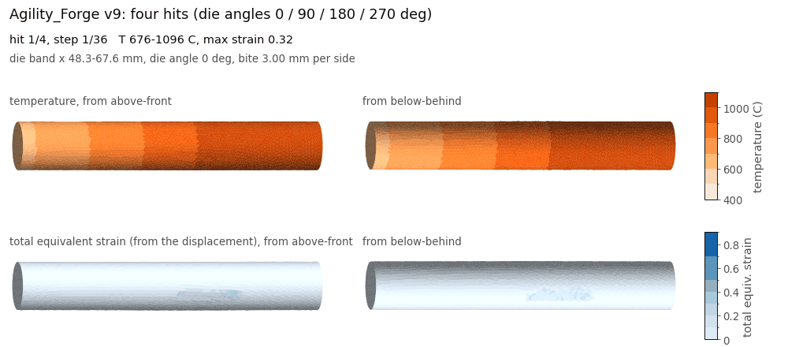

# Agility Forge

A GPU-accelerated finite element framework for modeling incremental forging processes with automatic differentiation capabilities.

## Overview

**Agility Forge** is built on [JAX-FEM](https://github.com/deepmodeling/jax-fem) and provides a comprehensive suite of tools for simulating metal forging operations. The framework combines:

- **GPU Acceleration**: JAX-based implementation for efficient large-scale simulations
- **Plasticity Modeling**: Advanced material models including J2 plasticity with hardening
- **Multi-physics**: Fully-coupled thermo-mechanical analysis
- **Inverse Analysis**: Built-in support for parameter identification and design optimization

This is **version 9** (November 2026): the forging model is corrected and two applications are added (see [What is new in version 9](#what-is-new-in-version-9)).



## Key Features

- **Constitutive Models**: J2 finite-strain plasticity with F-bar and nonlinear isotropic hardening, on TET4 or HEX8 meshes
- **Materials**: temperature-dependent 15-5PH stainless steel (yield stress, elastic modulus, hardening); 6063 aluminium at 400 C
- **Multi-Hit Forging**: configurable hit sequences with die rotation; between hits the die is released gradually and the bar is reheated
- **Die Contact**: contact re-detected at every load step on the deformed bar, the die only pushes; penalty contact with Coulomb friction on the real die shape (`Agility_Forge_Cooling`)
- **Heat Transfer**: conduction, heat from plastic work, die chilling on the contact faces; air convection and radiation (`Agility_Forge_physforge_full`)
- **Recorded Runs**: replay of measured forging runs, compared with 3-D scans and press force
- **Remeshing**: O-grid HEX8 remeshing before every hit and when elements degrade (`Agility_Forge_Cooling`)
- **Mesh Generation**: Gmsh for geometry creation and refinement
- **Post-processing**: VTK output and result GIFs
- **Time Stepping**: adaptive time stepping with retry logic and line-search fallback; every linear solve is checked and redone with a direct solver if it fails

## Versions

| Folder | Version | Content |
|---|---|---|
| `Example/` | 6 | monolithic code, one file per example (CIRP, Fine_mesh) |
| `Agility_Forge/` | 9 | scripted three- or four-hit demo on a cylindrical bar |
| `Agility_Forge_data/` | 9 | series of hits on the bar, stored in a database as training data |
| `Agility_Forge_physforge/` | 9 | replay of a recorded 17-hit forging run on a box billet |
| `Agility_Forge_physforge_full/` | 9, new | `Agility_Forge_physforge` with air convection and radiation |
| `Agility_Forge_Cooling/` | 9, new | two recorded 12-hit runs on 6063 aluminium at 400 C, compared with scans and press force |

Every folder has its own README with the model, the options, the results and the run times.

### What is new in version 9

Corrections in `Agility_Forge`, `Agility_Forge_data` and `Agility_Forge_physforge` (results of version 8 should be recomputed):

- During a hit: the die band is located on the deformed bar at the start of the hit; the die only pushes.
- Between hits: the die is released gradually, the reheat runs without contact, and the next hit's contact is built on the released surface.
- Plasticity and solver: the plastic history uses the step's own temperature and time step; failed linear solves are redone with a direct solver.
- Heat transfer: each step's own time step, lumped heat capacity and die transfer, exact face areas, die chilling only on the faces in contact, surface cooling toward 20 C.

The corrections are listed in `Agility_Forge/README.md` (section 6) and described with their measured effect in `Agility_Forge_physforge/README.md` (section 2a).

New applications: `Agility_Forge_physforge_full` and `Agility_Forge_Cooling`.

Unchanged: `jax_fem_checkpoint` and `Example/` (version 6).

### Example Configurations

| | **CIRP** (`Example/CIRP/`) | **Fine_mesh** (`Example/Fine_mesh/`) |
|---|---|---|
| Solver | Pure JAX solver | AMGX GPU-accelerated AMG solver |
| Mesh | Stock mesh (direct) | Gmsh-refined mesh |

## Installation

### Prerequisites
- Python >= 3.10 (version 9 was tested with Python 3.10, JAX 0.6.2, CUDA 12, one NVIDIA H100)
- JAX-FEM main repository
- `numpy`, `scipy`, `meshio`, `fenics-basix`, `gmsh`, `pyfiglet`, `PyYAML`, `matplotlib`
- Optional: `open3d` (mesh preparation), `pyamgx` and `cupy` (Fine_mesh), `petsc4py` built with MUMPS (`Agility_Forge_Cooling`), `h5py` (Cooling post-processing)

### Directory Setup

Clone (or copy) this repository so that the application folders sit inside `jax-fem/applications/`:

```
jax-fem/
├── applications/
│   ├── Example/                          # Version 6: monolithic examples (CIRP, Fine_mesh)
│   ├── Agility_Forge/                    # scripted multi-hit demo
│   ├── Agility_Forge_data/               # training-data generation
│   ├── Agility_Forge_physforge/          # recorded 17-hit run
│   ├── Agility_Forge_physforge_full/     # recorded run with air cooling
│   └── Agility_Forge_Cooling/            # recorded 400 C aluminium runs
├── jax_fem_checkpoint/                   # JAX-FEM checkpoint solver (included)
└── README.md
```

**Step 1**: Place `Example/` and the `Agility_Forge*` folders into `jax-fem/applications/`.

**Step 2**: Place `jax_fem_checkpoint/` into the `jax-fem/` root directory, replacing any existing copy.

```bash
cp -r jax_fem_checkpoint /path/to/jax-fem/
```

### Running the Program

All commands start from the `jax-fem/` root.

**Version 6** (monolithic):

```bash
python -m applications.Example.CIRP.jax_forge_hits
# or
python -m applications.Example.Fine_mesh.jax_forge_fine_mesh
```

**Version 9**:

```bash
python -m applications.Agility_Forge.main                       # three hits; --schedule four for four
python -m applications.Agility_Forge_data.main -s one_press -n 1 --no-noise --save-vtk
python -m applications.Agility_Forge_physforge.run_physforge \
    --n-hits 2 --save-vtk --depth-source scan --axial-constraint face_rx
python -m applications.Agility_Forge_physforge_full.run_physforge \
    --n-hits 2 --save-vtk --depth-source scan --axial-constraint face_rx
```

`Agility_Forge_Cooling` runs from its own folder with `jax-fem/` on `PYTHONPATH`; the full command is in its README:

```bash
cd applications/Agility_Forge_Cooling/calib_400C
export PYTHONPATH=/path/to/jax-fem
AGF_SERIES=roll3.1 python -u run_cold.py ...
```

Run times on one H100: `Agility_Forge` 28 min (three hits) and 45 min (four hits); `Agility_Forge_data` 28 min for the 5-hit `one_press` series; `Agility_Forge_physforge` about 10 min for 2 hits and 2.9 h for all 17; `Agility_Forge_physforge_full` about 3 % slower than `Agility_Forge_physforge`; `Agility_Forge_Cooling` 130 min (`roll2`) and 369 min (`roll3.1`) for 12 hits.

## Citation

If you use JAX-FEM, please cite:

```bibtex
@article{xue2023jaxfem,
  title={JAX-FEM: A Differentiable Framework for Finite Element Method},
  author={Xue, Tianju and others},
  journal={arXiv preprint arXiv:2212.00964},
  year={2022}
}
```


## References
- [JAX-FORGE Paper](https://authors.elsevier.com/sd/article/S0007-8506(26)00029-6)
- [JAX-FEM Repository](https://github.com/deepmodeling/jax-fem)
- [JAX-FEM Paper](https://arxiv.org/abs/2212.00964)
- Simo & Rifai (1990) - Enhanced strain methods

## Other related repo
- [JAX-CPFEM Repo](https://github.com/SuperkakaSCU/JAX-CPFEM)
- [JAX-PF Repo](https://github.com/SuperkakaSCU/JAX-PF)


## Support

For issues and questions, please contact Fangleihu2021@u.northwestern.edu
