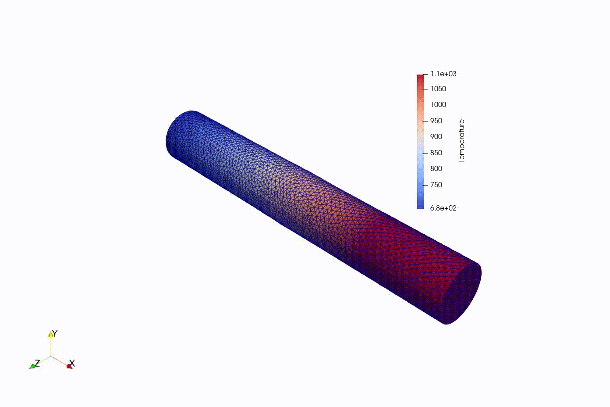

# Agility Forge

A GPU-accelerated finite element framework for modeling incremental forging processes with automatic differentiation capabilities.

## Overview

**Agility Forge** is built on [JAX-FEM](https://github.com/deepmodeling/jax-fem) and provides a comprehensive suite of tools for simulating metal forging operations. The framework combines:

- **GPU Acceleration**: JAX-based implementation for efficient large-scale simulations
- **Plasticity Modeling**: Advanced material models including J2 plasticity with hardening
- **Multi-physics**: Fully-coupled thermo-mechanical analysis
- **Inverse Analysis**: Built-in support for parameter identification and design optimization



## Key Features

- **Constitutive Models**: J2 finite-strain plasticity with F-bar method and nonlinear isotropic hardening
- **Temperature-Dependent Properties**: Yield stress, elastic modulus, hardening (15-5PH stainless steel)
- **Multi-Hit Forging**: Configurable hit sequence with rotation, displacement continuity across hits
- **Boundary Conditions**: Automatic contact-node detection on deformed geometry
- **Mesh Generation**: Integrated with Gmsh for flexible geometry creation and refinement
- **Post-processing**: VTK output and visualization tools
- **Time Stepping**: Adaptive time stepping with retry logic and line-search fallback

## Versions

This repository contains two versions of the forging simulation code. The only difference between them is **code organization** — the physics, algorithms, and results are identical.

| | Version 6 (`Example/`) | Version 8 (`Agility_Forge/`) |
|---|---|---|
| **Structure** | Single monolithic file per example | Modular: separate files for constitutive model, BCs, time-stepper, etc. |
| **Files** | `jax_forge_hits.py` (CIRP) / `jax_forge_fine_mesh.py` (Fine_mesh) | `main.py` + `lib/constitutive.py` + `lib/boundary_conditions.py` + `lib/time_stepper.py` + ... |
| **Use case** | Self-contained, easy to read end-to-end | Better for development and reuse |

### Example Configurations

| | **CIRP** (`Example/CIRP/`) | **Fine_mesh** (`Example/Fine_mesh/`) |
|---|---|---|
| Solver | Pure JAX solver | AMGX GPU-accelerated AMG solver |
| Mesh | Stock mesh (direct) | Gmsh-refined mesh |

## Installation

### Prerequisites
- Python >= 3.12
- CUDA 12 (for GPU support, optional)
- JAX-FEM main repository

### Directory Setup

Clone (or copy) this repository so that `Example/` and `Agility_Forge/` sit inside `jax-fem/applications/`:

```
jax-fem/
├── applications/
│   ├── Example/                        # Version 6 — monolithic examples
│   │   ├── CIRP/
│   │   │   ├── jax_forge_hits.py       # Main simulation (CIRP version)
│   │   │   └── mesh_container.py
│   │   └── Fine_mesh/
│   │       ├── jax_forge_fine_mesh.py   # Main simulation (fine-mesh version)
│   │       └── mesh_container.py
│   └── Agility_Forge/                   # Version 8 — modular refactor
│       ├── main.py                      # Entry point
│       ├── hit_config.py                # Hit dataclass
│       ├── material_data.py             # Material property tables
│       ├── mesh_container.py            # Mesh I/O utilities
│       └── lib/
│           ├── constitutive.py          # ThermalMechanical Problem class
│           ├── boundary_conditions.py   # BC construction & surface integral refresh
│           └── time_stepper.py          # Adaptive time-stepper
├── jax_fem_checkpoint/                  # JAX-FEM checkpoint solver (included)
└── README.md
```

**Step 1**: Place `Example/` and `Agility_Forge/` into `jax-fem/applications/`.

**Step 2**: Place `jax_fem_checkpoint/` into the `jax-fem/` root directory.

```bash
cp -r jax_fem_checkpoint /path/to/jax-fem/
```

### Running the Program

**Version 6** (monolithic — run directly):

```bash
cd /path/to/jax-fem
python -m applications.Example.CIRP.jax_forge_hits
# or
python -m applications.Example.Fine_mesh.jax_forge_fine_mesh
```

**Version 8** (modular — run as module):

```bash
cd /path/to/jax-fem
python -m applications.Agility_Forge.main
```

## Citation

If you use JAX-FEM, please cite:

```bibtex
@article{xue2023jaxfem,
  title={JAX-FEM: A Differentiable Framework for Finite Element Method},
  author={Xue, Tianju and others},
  journal={arXiv preprint arXiv:2212.00964},
  year={2022}
}
```


## References
- [JAX-FORGE Paper](https://authors.elsevier.com/sd/article/S0007-8506(26)00029-6)
- [JAX-FEM Repository](https://github.com/deepmodeling/jax-fem)
- [JAX-FEM Paper](https://arxiv.org/abs/2212.00964)
- Simo & Rifai (1990) - Enhanced strain methods

## Other related repo
- [JAX-CPFEM Repo](https://github.com/SuperkakaSCU/JAX-CPFEM)
- [JAX-PF Repo](https://github.com/SuperkakaSCU/JAX-PF)


## Support

For issues and questions, please contact Fangleihu2021@u.northwestern.edu
